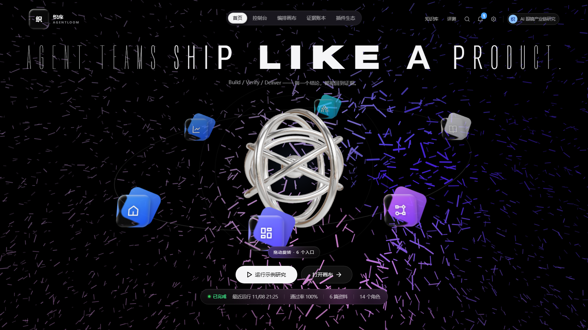

# 织序 AgentLoom

> 把一支 Agent 团队，织成可验证的执行流。

织序 AgentLoom 是 2026 第五届“未来杯”创新大赛 **赛题一（Agent 编排创新应用）** 的参赛项目：一个面向多 Agent 协作的**可视化编排、动态调度、工具调用、执行与验证平台**。

它不只是把几个 Agent 串起来，而是把“团队怎么组、每个节点会用什么工具、结果怎么验”变成可配置、可观察、可回放的运行时能力。

> **在线演示**：<http://103.68.192.80/>（Mock 模式，7 篇资料 / 15 个插件；无需登录，可直接跑一次完整回环）
> 源码：<https://github.com/zhongqing725/agentloom>

> 交接请先读 [docs/handover.md](docs/handover.md)；文档导航见 [docs/README.md](docs/README.md)。



> 11/8 清洁演示数据：1 条运行、100% 通过率、14 个角色。插件页与运行事件流截图见同目录 `02-plugins.png`、`03-run-events.png`。

## 技术栈

- **前端**：React 19、Vite 7、TypeScript、React Router 7、React Flow 12、BoardUI 源组件、Tailwind CSS v4（PostCSS）、Remix Icon。
- **后端**：Fastify 5、SQLite（Node `node:sqlite`）、SSE、`unpdf`（PDF 文本抽取）。
- **设计系统**：BoardUI 语义 token；首页暗色、控制台浅色，截图见 `docs/boardui/`。
- 不使用 Next.js、Server Component、next/font 或 next/navigation；这是纯 Vite 前端 + Fastify API。

## 为什么是“节点能力插件”

大多数 Agent 平台在“团队”这一层做文章：加角色、连线、跑流程。织序把粒度再往下压一层：

```text
Agent 节点 = 角色 + 模型 + 知识源 + 能力插件
```

插件不绑定某个 Agent，而是像显卡一样插到任意节点上：

- `cognition.diverge`：把一个节点展开成稳健 / 进取 / 反方三条思维分支，由裁判收敛。
- `verify.citations`：逐条核对结论与证据，不通过就触发 Self-Loop。
- `knowledge.retrieve`：从项目知识库召回证据，并作为 `knowledge_search` 工具执行。
- `tool.calculator`：沙箱算术工具，派生数字必须经过它，调用会写入事件流。
- `cognition.critique` / `decompose` / `strawman` / `debate`：在输出后追加自我批判、任务分解、反方论证或辩论纪要。
- `knowledge.graph` / `knowledge.freshness`：图谱邻居扩展与按发布时间重排证据。
- `verify.numbers` / `verify.entailment`：数值一致性审计与四态蕴含统计。
- `tool.python`（受限数据统计）/ `tool.browser`（公开页面抓取）：真实工具，不执行任意代码。

工具运行时只做三件事：把 `Agent.tools` 里的 id 映射到工具注册表；Live 模式把同一份 JSON Schema 交给模型的 function calling；Mock 模式直接执行工具，保证离线演示也有真实的 `tool.call` / `tool.result` 轨迹。

同一个“发散卡”，插到投研 Agent 上会展开投资情景，插到写作 Agent 上会展开叙事结构。**插件管思考方式，Agent 管领域知识**——这是“万用”的真正含义。

## 五个核心能力

### 1. 知识库 grounding

- Markdown / TXT / PDF 入库；PDF 按页抽取并保留页码标记，扫描件会被拒绝。
- 文档记录来源链接、类型（论文 / 报告 / 报道 / 公告）与发布时间，引用可回查。
- 中文 BM25 检索，词级分词 + 双字回退。
- 每条证据有稳定引用编号，报告中的 `[M2]` 可回查原文。

### 2. 可视化编排

- 默认 10 个节点的 DAG：输入 → 规划 → 三路并行研究 → 分析 → 写作 → 核查 → 终稿；团队库共 14 个角色，未上画布的可从「添加 Agent → 团队库」直接插入。
- 节点可拖动、连线、删除；位置自动保存。
- 添加专家节点：插入“风险审查员/数据可视化师/合规审查员”，自动接到下游。
- 15 个插件都有服务端运行时：知识插件改变检索，认知/验证插件追加产出，工具插件进入 function calling。

### 3. 工具运行时

- `calculator`：递归下降解析，只接受数字与 `+ - * / ( )`，不走 `eval`；测试覆盖恶意输入。
- `knowledge_search`：复用 BM25，返回片段、来源与评分。
- `data_stats`：受限统计工具（mean / median / sum / min / max），不执行任意代码。
- `browser_fetch`：公开 http(s) 页面抓取，拦截 localhost/内网地址，8 秒超时。
- Live 模式走 OpenAI `tools` 协议，最多 3 跳；Mock 模式照样执行真工具。
- 每次调用写入 `tool.call` / `tool.result` 事件，运行页与节点输出都可回放。

### 4. 动态调度

- 就绪队列按关键路径深度排序。
- 三路研究并行执行，受 `maxConcurrency` 控制。
- 节点失败自动重试；预算超限停止模型调用。
- 每个调度动作都以事件形式写入 SSE，可实时观察、可回放。

### 5. Self-Loop 与验证

- 核查员抽取报告中的结论与引用。
- 四态判定：`supported` / `partial` / `contradicted` / `unsupported`，并检查方向、单位、统计期间、主体与数字锚点。
- **覆盖与冲突核验**（`verify.coverage` 插件）：知识库先被规则编译成市场 / 产业链 / 竞争三页事实卡（不调模型、不落库），再检查报告是否漏掉关键事实、是否回避资料间分歧。
- 三维判定：引用 / 覆盖 / 冲突三项都过阈值才算通过；任一项不达标，就按失败的那一维路由。
- 不通过时按类型路由：缺引用回研究员，数字不一致回分析师，遗漏事实回写作，未说明口径差异回分析师，表述问题回写作。
- 第 2 轮写作自动补一段“口径差异与关键事实补录”，缺的证据铸成 `[W…]` 引用。
- 证据账本：逐条主张、引用原文、支持状态、核查结论与路由目标。
- 默认最多回环 2 次，最终报告保留核查分与逐条结论。

### 6. 记忆、条件分支与负载调度

- **短期记忆**：每次节点完成后写入 SQLite `agent_memory`；下一轮按任务关键词召回最近 3 条，注入 Live prompt。`GET/POST/DELETE /api/agents/:id/memory` 可查看、手写、清空；团队页节点弹窗可直接操作。
- **条件分支**：`condition` 节点读取上游输出路径（如 `verdict.score`），按 `gte / lte / eq` 判定；出边标记 `condition: true|false`，调度器只走命中分支，未命中的节点标记 `skipped` 并解除下游阻塞。画布可新建/编辑条件。
- **子工作流**：`subflow` 节点引用另一张 workflow，执行独立 child Run（最多 2 层）；父节点输出带 `subflowRunId`。
- **负载调度**：每个 Agent 有 `capacity`；就绪队列按“关键路径深度 → 当前 Agent 负载 → 画布 x”排序，容量满时等待。`node.queued` 事件带 `agentLoad` / `agentCapacity`，可在事件流里核对。
- **人工干预**：运行可暂停/继续；每个节点完成写 checkpoint，`GET /api/runs/:id/checkpoints` 可查。不是完整审批流，也不是任意 checkpoint 回滚。

### 7. MCP / A2A / 混合检索

- **MCP**：内置 stdio 客户端，支持 `initialize`、`tools/list`、`tools/call`。用 `AGENTLOOM_MCP_SERVERS` 配置外部 MCP 服务，工具自动进入同一套 Function Calling；`scripts/mcp-demo-server.mjs` 是可运行的示例。
- **A2A**：`/.well-known/agent.json` 提供 Agent Card；`POST /a2a` 支持 JSON-RPC `message/send`、`tasks/get`、`tasks/cancel`，可被其他 Agent 发现并委派任务。
- **混合检索**：BM25 + SQLite `chunk_vectors` 向量余弦；`knowledge_search` 返回 `score` 与 `vectorScore`。默认使用 192 维特征哈希；配置 `AGENTLOOM_EMBEDDING_URL` / `AGENTLOOM_EMBEDDING_MODEL` / `AGENTLOOM_EMBEDDING_API_KEY` 后自动调用 OpenAI-compatible `/embeddings`，把 `chunk_vectors` 升级为神经 embedding，失败回退哈希。

演示运行的真实轨迹（`run-91bc6a30`，线上 Mock）：

```text
第 1 轮核查：引用 86% / 覆盖 71% / 冲突 0%，9 条问题
        （3 条引用/数字；2 条关键事实漏写；4 处资料分歧未说明口径）
        ↓ 路由：conflict → 首席分析师；下游撰写/核查随依赖重跑
第 2 轮核查：100% / 100% / 100%，0 条问题，通过
```

## 快速开始

要求：Node.js 22.19+ 或 24+，pnpm 10+。

```bash
pnpm install
pnpm dev
```

- Web：http://127.0.0.1:5173
- API：http://127.0.0.1:8787

生产模式：

```bash
pnpm build
pnpm start
# http://127.0.0.1:8787
```

首次启动会自动建库、写入 7 篇演示资料、14 个 Agent 和示例工作流。数据在 `data/agentloom.db`；`pnpm reset` 只重建数据库，保留 `data/` 里的评测基准与来源文件。

开发验证：

```bash
pnpm typecheck
pnpm smoke:all   # 主流程 + 条件分支 + 子流程 + MCP stdio
pnpm build
```

压力与真实模型证据（需要服务已启动）：

```bash
pnpm stress                 # Mock 并发/延迟，写入 docs/stress-report.md
pnpm live-evidence          # 需要 AGENTLOOM_API_KEY；有 Key 会跑真实任务
```

如果 5173 页面显示成无样式的裸 HTML，通常是旧的 Vite 进程在 `postcss.config.mjs` 出现之前启动的；重启 `dev:web` 即可，不需要改页面代码。

## 接入真实模型

默认是 **Mock 演示模式**，无需 API Key 即可完整跑通流程，适合录制与离线演示。

在页面右上角“设置”中填入 DeepSeek API Key，或使用环境变量：

```bash
AGENTLOOM_API_KEY=sk-...
AGENTLOOM_BASE_URL=https://api.deepseek.com/v1
AGENTLOOM_MODEL=deepseek-chat
AGENTLOOM_LIVE_MAX_LOOP=1
pnpm dev
```

设置页保存的 Key 只存在当前服务进程内，不写入数据库；重启服务后按环境变量重新判断模式。

神经向量（可选）：配置 `AGENTLOOM_EMBEDDING_URL`（OpenAI-compatible `/embeddings`）、`AGENTLOOM_EMBEDDING_MODEL`、`AGENTLOOM_EMBEDDING_API_KEY` 后，首次检索会把 `chunk_vectors` 升级为真实 embedding；失败自动回退特征哈希。

Live 模式下，`Agent.tools` 里的工具会以 OpenAI `tools` 协议下发给模型，模型返回 `tool_calls` 后由本地注册表执行；Mock 模式直接执行同一套工具，因此离线演示也能看到真实的工具轨迹。

## 架构

```text
┌──────────────────────────────────────────────────────────┐
│  React Console                                           │
│  首页 / 知识库 / Agent 团队 / 编排 / 运行 / 评测 / 训练  │
└───────────────────────┬──────────────────────────────────┘
                        │ REST + SSE
┌───────────────────────▼──────────────────────────────────┐
│  Fastify API                                             │
│  /api/runs  /api/kb  /api/agents  /api/workflow          │
└───────────────────────┬──────────────────────────────────┘
                        │
┌───────────────────────▼──────────────────────────────────┐
│  Orchestration Runtime                                   │
│  ┌─────────────┐  ┌─────────────┐  ┌─────────────────┐   │
│  │ Scheduler   │  │ DAG Engine  │  │ Self-Loop       │   │
│  │ 优先级/并发 │  │ 依赖/分支   │  │ 核查→回写→重跑  │   │
│  └─────────────┘  └─────────────┘  └─────────────────┘   │
│  ┌─────────────┐  ┌─────────────┐  ┌─────────────────┐   │
│  │ Agent Nodes │  │ Plugins     │  │ Verifier        │   │
│  │ 14 roles    │  │ 14 runtime  │  │ 四态蕴含        │   │
│  └─────────────┘  └─────────────┘  └─────────────────┘   │
│  ┌─────────────────────────────────────────────────────┐  │
│  │ Tool Registry  calculator / knowledge_search        │  │
│  └─────────────────────────────────────────────────────┘  │
└──────────┬───────────────────┬───────────────────────────┘
           │                   │
     ┌─────▼─────┐       ┌─────▼──────────┐
     │ SQLite    │       │ Model Gateway  │
     │ runs/events│      │ Mock / DeepSeek│
     └───────────┘       └────────────────┘
```

更完整的技术设计见 [docs/architecture.md](docs/architecture.md)。

## 提交材料

| 材料 | 文件 |
|---|---|
| **交接说明（接手先读）** | [docs/handover.md](docs/handover.md) |
| 项目白皮书（Word / PDF） | `deliverables/织序AgentLoom-项目白皮书.docx` / `.pdf` |
| 项目介绍 PPT（PPTX / PDF） | `deliverables/织序AgentLoom-项目介绍.pptx` / `.pdf` |
| 3 分钟演示脚本 | [docs/demo-script.md](docs/demo-script.md) |
| 技术架构 | [docs/architecture.md](docs/architecture.md) |
| 赛题一能力对照 | [docs/track1-compliance.md](docs/track1-compliance.md) |
| 验证与工具证据 | [docs/verification.md](docs/verification.md) |
| 当前 UI 截图 | [docs/boardui/](docs/boardui/) |
| 白皮书源稿 | [docs/white-paper.md](docs/white-paper.md) |
| 文档索引 | [docs/README.md](docs/README.md) |
| 提交清单 | `deliverables/提交清单.md` |

> 白皮书与 PPT 中的团队名称、成员姓名目前是 `【待填】` 占位，提交前替换为报名信息。
> 演示数据为模拟整理，已在界面与文档中标注；真实模型成本需接入 DeepSeek 后复测。
> 已生成的白皮书/PPT 可能仍使用迁移前截图；若要同步当前 BoardUI 界面，请重新截图并重新导出。

## 目录

```text
src/
  server/
    engine.ts      调度器、DAG 执行、Self-Loop、工具事件
    llm.ts         Mock / DeepSeek 适配、function calling、发散、核查
    tools.ts       工具注册表：calculator / knowledge_search / data_stats / browser_fetch
    mcp.ts         MCP stdio 客户端（tools/list、tools/call）
    a2a.ts         A2A Agent Card + message/send + tasks/get
    entailment.ts  四态主张判定
    trainer.ts     提示词候选训练与版本启用
    retrieval.ts   中文 BM25 + 轻量向量索引
    seed.ts        演示知识库、Agent、插件、工作流
    db.ts          SQLite 数据访问、记忆、向量、容量
    index.ts       Fastify API + SSE
  web/
    App.tsx        应用 shell、导航、运行/设置 Modal
    pages/         首页、知识库、团队、编排、运行、评测、插件、训练
    components/    React Flow 画布、自定义节点、共享 UI
  components/      BoardUI 源组件（免费组件）
  styles/          BoardUI tokens + AgentLoom 主题
  utils/           cx / directional icon
  shared/
    types.ts       领域类型
docs/
  handover.md      交接说明
  README.md        文档索引
  architecture.md  技术架构
  verification.md  验证与工具证据
  stress-report.md 压力/并发测试报告
  live-evidence.md Live 模型证据（有 Key 时生成）
  demo-script.md   3 分钟演示脚本
  boardui/         当前 UI 截图（桌面 3 / 移动 1）
  mcp-demo-server.mjs  MCP 示例服务
  stress-run.mjs       压力测试
  live-evidence.mjs    Live 证据采集
boardui.json       BoardUI 路径/别名配置
postcss.config.mjs Tailwind v4 PostCSS 配置
```

## 演示场景

**AI 眼镜产业链投研**：上传 7 篇产业资料，交给工作流里的 8 个 Agent（团队库共 14 个角色）。三路研究并行，首席分析师用三视角发散、调用 `calculator` 复核规模数字并裁判收敛，撰写师产出带引用的报告；核查员装上 `verify.coverage` 后，第一轮查出引用缺口、2 条漏写事实与 4 处未说明的资料分歧（2028 出货量 3200 vs 5000 万台、复合增速 65% vs 85%、退货率 15% vs 12%、Meta 份额 62% vs 55%），回环一轮后三维全部通过。

这不是一个“聊天机器人”，而是一条可以被观察、被干预、被验证的研究生产线。

## 当前边界

- 15 个插件都有运行时；工具侧有 `calculator`、`knowledge_search`、`data_stats`、`browser_fetch`。`tool.python` 是受限统计，不执行任意代码。
- MCP 是 stdio 客户端，需要外部 MCP 服务；默认不启动。A2A 是可运行的兼容子集（Agent Card + message/send + tasks/get + tasks/cancel），不是完整 A2A SDK。
- 条件节点支持单条件与 true/false 两路，不支持 and/or 组合表达式；画布可新建/编辑。
- 子工作流通过 child Run 执行，最多 2 层；画布可插入，模板通过 seed/API 配置，暂无模板编辑器。
- 运行支持暂停/继续与 checkpoint 记录，但没有回滚到任意 checkpoint 的恢复执行。
- 混合检索默认是 192 维特征哈希；配置 `AGENTLOOM_EMBEDDING_URL` 后切换为 OpenAI-compatible 神经 embedding，API 失败自动回退哈希。
- `browser_fetch` 需要外网，且只允许公开 http(s) 地址；Demo 里默认不挂到主流程，避免现场网络抖动。
- 知识库支持 Markdown / TXT / PDF；扫描件没有文字层会被拒绝，OCR 不在范围内。
- 当前只有一张演示工作流；多项目、多工作流选择、认证、多租户、插件市场不在本届 MVP。
- Mock 模式的 Token 与成本为模拟计量；Live 真实模型 3/3 通过：**`run-56f27e37` / `run-8eebae66` / `run-c6d116ac` 均 1.0**（17+3、16+6、19+8 条主张，0 条越证断言），142–328 秒、$0.043–0.071、20–44 次工具调用。核查分口径是「真正断言了事实的主张里，有多少被引用坐实」，已声明为证据缺口的主张只披露、不计入分母（否则越诚实分越低）；断言数为 0 直接判 0 分。Mock 的 1.0 是固定剧本，两者不要混说。
- Live 默认 `AGENTLOOM_LIVE_MAX_LOOP=1`，避免现场多跑一轮；工具调用已限制每 hop 6 次、每节点 12 次。
- 压力测试是单进程 Mock 基线；并发能力受 Node 单进程和 SQLite 限制，不是生产级分布式调度。

## 赛事信息

- 赛道：赛题一（Agent 编排创新应用）
- 命题：大模型 Agent 工具编排调度平台
- 截止：2026 年 11 月 20 日
- 官网：https://www.omniedu.com/ai-hub/contest

## License

本项目为参赛作品，源代码与文档版权归团队所有。公开仓库仅授权用于本届“未来杯”评审与学习交流，未经书面许可不得商用或再分发；完整条款见 [LICENSE](./LICENSE)。第三方组件许可见 [THIRD_PARTY_NOTICES.md](./THIRD_PARTY_NOTICES.md)。
