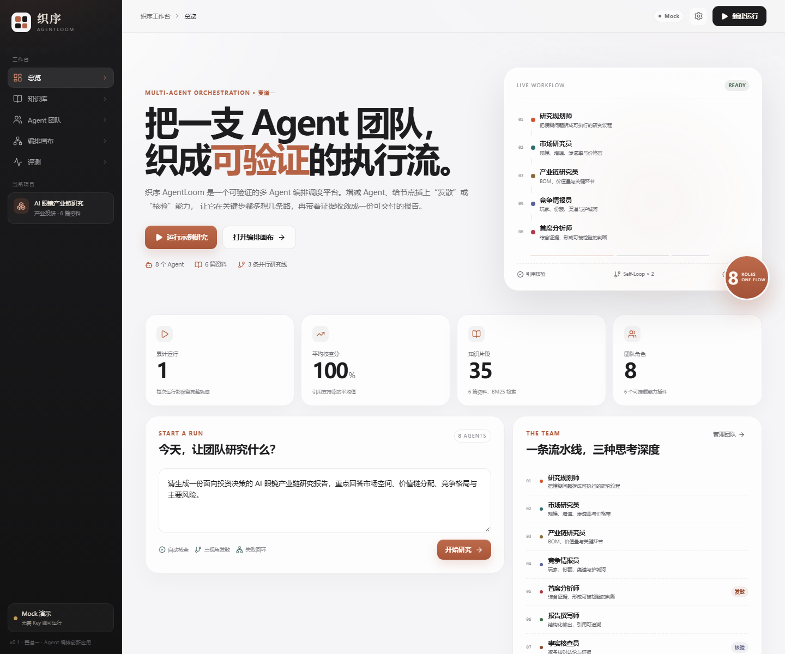

# 织序 AgentLoom

> 把一支 Agent 团队，织成可验证的执行流。

织序 AgentLoom 是 2026 第五届“未来杯”创新大赛 **赛题一（Agent 编排创新应用）** 的参赛项目：一个面向多 Agent 协作的**可视化编排、动态调度、执行与验证平台**。

它不只是把几个 Agent 串起来，而是把“团队怎么组、每个节点怎么想、结果怎么验”变成可配置、可观察、可回放的运行时能力。



## 为什么是“节点能力插件”

大多数 Agent 平台在“团队”这一层做文章：加角色、连线、跑流程。织序把粒度再往下压一层：

```text
Agent 节点 = 角色 + 模型 + 知识源 + 能力插件
```

插件不绑定某个 Agent，而是像显卡一样插到任意节点上：

- `cognition.diverge`：把一个节点展开成稳健 / 进取 / 反方三条思维分支，由裁判收敛。
- `verify.citations`：逐条核对结论与证据，不通过就触发 Self-Loop。
- `knowledge.retrieve`：从项目知识库召回证据，并生成可追溯引用。
- `cognition.critique` / `cognition.debate` / `tool.calculator`：已进入插件库，作为下一阶段扩展。

同一个“发散卡”，插到投研 Agent 上会展开投资情景，插到写作 Agent 上会展开叙事结构。**插件管思考方式，Agent 管领域知识**——这是“万用”的真正含义。

## 四个核心能力

### 1. 知识库 grounding

- Markdown / TXT 入库，按语义段落切分。
- 中文 BM25 检索，词级分词 + 双字回退。
- 每条证据有稳定引用编号，报告中的 `[M2]` 可回查原文。

### 2. 可视化编排

- 10 个节点的 DAG：输入 → 规划 → 三路并行研究 → 分析 → 写作 → 核查 → 终稿。
- 节点可拖动，位置自动保存。
- 点击节点查看角色、模型、提示词，并直接挂载/卸载插件。

### 3. 动态调度

- 就绪队列按关键路径深度排序。
- 三路研究并行执行，受 `maxConcurrency` 控制。
- 节点失败自动重试；预算超限停止模型调用。
- 每个调度动作都以事件形式写入 SSE，可实时观察、可回放。

### 4. Self-Loop 与验证

- 核查员抽取报告中的结论与引用。
- 检查引用是否存在、数字是否与证据一致、语义是否重叠。
- 低于阈值时，带着问题清单回到写作节点重写。
- 默认最多回环 2 次，最终报告保留核查分与逐条结论。

演示运行的真实轨迹：

```text
第 1 轮核查：85%，2 条问题（数字 5000 万 vs 证据 3200 万；2027 洗牌缺少引用）
        ↓ Self-Loop
第 2 轮核查：100%，通过
```

## 快速开始

要求：Node.js 22.19+ 或 24+，pnpm 10+。

```bash
pnpm install
pnpm dev
```

- Web：http://127.0.0.1:5173
- API：http://127.0.0.1:8787

生产模式：

```bash
pnpm build
pnpm start
# http://127.0.0.1:8787
```

首次启动会自动建库、写入 6 篇演示资料、8 个 Agent 和示例工作流。数据在 `data/agentloom.db`，删除 `data/` 即可重置。

## 接入真实模型

默认是 **Mock 演示模式**，无需 API Key 即可完整跑通流程，适合录制与离线演示。

在页面右上角“设置”中填入 DeepSeek API Key，或使用环境变量：

```bash
AGENTLOOM_API_KEY=sk-...
AGENTLOOM_BASE_URL=https://api.deepseek.com/v1
AGENTLOOM_MODEL=deepseek-chat
pnpm dev
```

设置页保存的 Key 只存在当前服务进程内，不写入数据库。

## 架构

```text
┌──────────────────────────────────────────────────────────┐
│  React Console                                           │
│  总览 / 知识库 / Agent 团队 / 编排画布 / 运行 / 评测      │
└───────────────────────┬──────────────────────────────────┘
                        │ REST + SSE
┌───────────────────────▼──────────────────────────────────┐
│  Fastify API                                             │
│  /api/runs  /api/kb  /api/agents  /api/workflow          │
└───────────────────────┬──────────────────────────────────┘
                        │
┌───────────────────────▼──────────────────────────────────┐
│  Orchestration Runtime                                   │
│  ┌─────────────┐  ┌─────────────┐  ┌─────────────────┐   │
│  │ Scheduler   │  │ DAG Engine  │  │ Self-Loop       │   │
│  │ 优先级/并发 │  │ 依赖/分支   │  │ 核查→回写→重跑  │   │
│  └─────────────┘  └─────────────┘  └─────────────────┘   │
│  ┌─────────────┐  ┌─────────────┐  ┌─────────────────┐   │
│  │ Agent Nodes │  │ Plugins     │  │ Verifier        │   │
│  │ 8 roles     │  │ 节点级挂载  │  │ 引用/数字/语义  │   │
│  └─────────────┘  └─────────────┘  └─────────────────┘   │
└──────────┬───────────────────┬───────────────────────────┘
           │                   │
     ┌─────▼─────┐       ┌─────▼──────────┐
     │ SQLite    │       │ Model Gateway  │
     │ runs/events│      │ Mock / DeepSeek│
     └───────────┘       └────────────────┘
```

更完整的技术设计见 [docs/architecture.md](docs/architecture.md)。

## 提交材料

| 材料 | 文件 |
|---|---|
| 项目白皮书（Word / PDF） | `deliverables/织序AgentLoom-项目白皮书.docx` / `.pdf` |
| 项目介绍 PPT（PPTX / PDF） | `deliverables/织序AgentLoom-项目介绍.pptx` / `.pdf` |
| 3 分钟演示脚本 | [docs/demo-script.md](docs/demo-script.md) |
| 技术架构 | [docs/architecture.md](docs/architecture.md) |
| 白皮书源稿 | [docs/white-paper.md](docs/white-paper.md) |
| 提交清单 | `deliverables/提交清单.md` |

> 白皮书与 PPT 中的团队名称、成员姓名目前是 `【待填】` 占位，提交前替换为报名信息。
> 演示数据为模拟整理，已在界面与文档中标注；真实模型成本需接入 DeepSeek 后复测。

## 目录

```text
src/
  server/
    engine.ts      调度器、DAG 执行、Self-Loop
    llm.ts         Mock / DeepSeek 适配、发散、裁判、核查
    retrieval.ts   中文 BM25
    seed.ts        演示知识库、Agent、插件、工作流
    db.ts          SQLite 数据访问
    index.ts       Fastify API + SSE
  web/
    pages/         总览、知识库、团队、编排、运行、评测
    components/    React Flow 节点、UI 组件
  shared/
    types.ts       领域类型
docs/
  architecture.md  技术架构
  demo-script.md   3 分钟演示脚本
```

## 演示场景

**AI 眼镜产业链投研**：上传 6 篇产业资料，交给 8 个 Agent。三路研究并行，首席分析师用三视角发散并裁判收敛，撰写师产出带引用的报告，核查员发现 2 个问题后触发回环，第二轮通过。

这不是一个“聊天机器人”，而是一条可以被观察、被干预、被验证的研究生产线。

## 当前边界

- MVP 的“发散”与“引用核验”已经落到运行时；插件目录中的“辩论 / 数值计算”是下一步扩展。
- 知识库当前支持 Markdown / TXT；PDF 解析在路线图中。
- 认证、多租户、插件市场不在本届 MVP 范围内。
- Mock 模式的 Token 与成本为模拟计量，用于演示口径。

## 赛事信息

- 赛道：赛题一（Agent 编排创新应用）
- 命题：大模型 Agent 工具编排调度平台
- 截止：2026 年 11 月 20 日
- 官网：https://www.omniedu.com/ai-hub/contest

## License

本项目为参赛作品，源代码与文档版权归团队所有。
